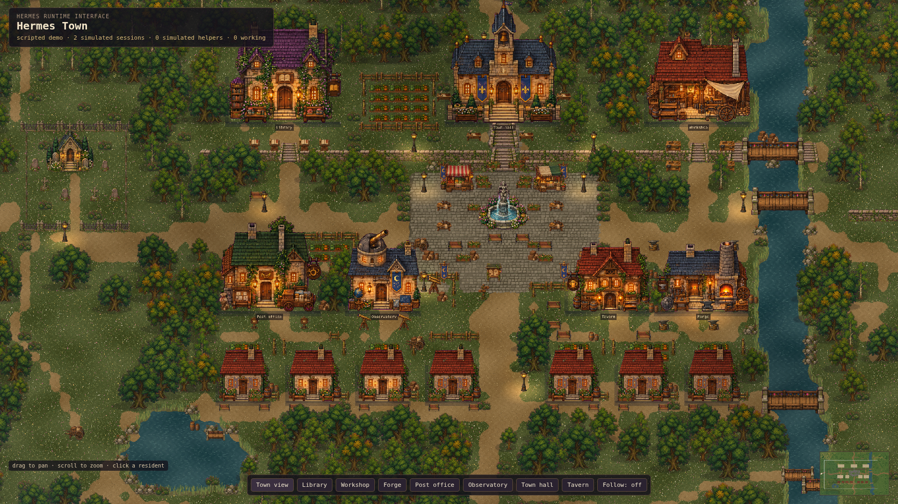

# Hermes Town Brent

A local pixel-art interface for Hermes Agent. Plugin id `hermes-town-brent`; the command stays `hermes town`. Every resident represents a real Hermes execution context. Tool calls send residents to the library, workshop, forge, post office, observatory, or town hall. Completed sessions rest at the tavern and eventually walk home.



> v0.5.2 is the current release under the independent **Hermes Town Brent** identity (plugin id `hermes-town-brent`, introduced in v0.5.0). It packages the bridge, local server, and prebuilt town together, serves one shared Town for every local Hermes profile, and has the Appearance drawer. Runtime use needs Hermes and Node.js, not a repository checkout, npm, or a frontend build. It is installed from this repository; it is not the `hermes-town` plugin-catalog entry and is not listed in the Hermes plugin catalog unless a separate catalog entry says so. See [Switching from the legacy `hermes-town` plugin](#switching-from-the-legacy-hermes-town-plugin).

## Requirements

- [Hermes Agent](https://github.com/NousResearch/hermes-agent) 0.21.2, the validated preview baseline
- Node.js `^20.19.0` or `>=22.12.0`
- npm only for contributors building from source

## Try the demo

The built-in scripted demo simulates every session in the browser; nothing in it connects to a Hermes runtime.

To run the demo locally:

```bash
git clone https://github.com/brent-at-realty/hermes-town.git
cd hermes-town
npm ci
npm run dev
```

Open `http://127.0.0.1:5173/?agents=demo&hour=17`.

## Connect a local Hermes runtime

### Packaged plugin

Install the plugin id `hermes-town-brent`. Once a catalog entry for it is merged:

```bash
hermes plugins install hermes-town-brent
hermes plugins enable hermes-town-brent
hermes town start
```

Open the printed local URL, normally `http://127.0.0.1:4187/`. Use `hermes town start --open` to also open a browser on a machine with a graphical session.

Start a **new Hermes CLI session**, or restart the gateway you want to observe, then run a turn. Installing/enabling the plugin does not reload an already-running process. Town never restarts Hermes for you.

```bash
hermes town status          # setup, server ownership, first-event diagnostics
hermes town status --json   # machine-readable diagnostics
hermes town stop            # stop only this profile's managed Town server
hermes town open            # reopen the browser
hermes town setup           # optional prerequisite/token check without starting
```

`start` creates a private token if needed and launches the bundled server on loopback. Repeating it reuses the same healthy managed process. `stop` authenticates that exact process with a separate private management secret, never a PID from a stale file. It does not disable the Hermes plugin. The server is not a login service: after reboot, run `hermes town start` again.

Until then, or without the catalog, a Git install of the exact reviewed commit is supported by Hermes (`hermes plugins install "brent-at-realty/hermes-town#integrations/hermes-town-plugin" --ref <40-hex commit>`; see `hermes plugins install --help`), and the developer fallback below copies the same bytes. It installs as `hermes-town-brent`. Hermes treats a non-catalog source as unreviewed: its install scanner reports `caution` findings for this plugin (a launcher that starts the bundled Node server with `subprocess`, and the minified browser bundle) and refuses the install unless you review them and pass `--force`. Catalog-pinned installs accept `caution` without a prompt, which is why the catalog path is preferred when available. The plugin never downloads replacements for its reviewed code.

### Switching from the legacy `hermes-town` plugin

`hermes-town-brent` is a different plugin from the earlier `hermes-town` catalog entry. Both own the `hermes town` command and the same lifecycle hooks, so they must not be enabled together. Nothing here overwrites, migrates, or deletes the legacy plugin or its state:

- The developer installer (`npm run install:plugin`) refuses while `hermes-town` is enabled in the target Hermes home, before it writes anything, and prints the steps. If the legacy plugin is only installed (not enabled) it installs beside it and says so.
- If both end up enabled anyway, `hermes-town-brent` logs a warning and stays inert (no hooks, no command) so the legacy plugin keeps running its own bytes.
- To switch: `hermes town stop` (while the legacy plugin is still enabled), then `hermes plugins disable hermes-town` (or `hermes plugins remove hermes-town`), then `hermes plugins enable hermes-town-brent`, then start a new Hermes session and `hermes town start`.
- Runtime state and protocol names are unchanged: `$HERMES_HOME/hermes-town/runtime/` (and `hermes-town-shared/`), the `hermes-town.*.v1` wire versions, the `HERMES_TOWN_*` environment variables and the `hermes-town.appearance` browser key. An existing token and journal are therefore reused by the new plugin; remove them yourself if you want a clean start.

### Profiles and remote hosts

Use the same profile for Town and the Hermes process you observe:

```bash
hermes -p work town start
hermes -p work town status
hermes -p work town stop
```

State stays under that profile's Hermes home. Multiple profiles on one host need distinct ports and matching `HERMES_TOWN_BRIDGE_URL=http://127.0.0.1:PORT/api/town/ingest` in both the observed Hermes process and the Town CLI environment. A port mismatch is refused, not silently "connected". `hermes town start --port PORT` must match that setting. Managed mode uses the profile's token; external token paths and HTTPS ingest setups remain advanced/manual deployments.

### One shared Town for every local profile

Instead of one server and port per profile, run a single Town that every profile on this host publishes into. Each resident wears a clothing colour that identifies its profile, and a legend under the status line lists the profiles currently in town.

```bash
# 1. Once, from any profile (or the default one): register every local profile
#    (the default home and each <root>/profiles/<name>) and give each its own
#    private token. Token values are never printed.
hermes town setup --shared

# 2. Install and enable the plugin in each profile you want observed
#    (plugins are per profile; repeat with -p NAME for every one).
hermes -p work plugins install hermes-town-brent
hermes -p work plugins enable hermes-town-brent

# 3. Start the one shared server (loopback, default port 4187).
hermes town start --shared
hermes town status --shared               # per-profile token, acceptance and event counts
hermes town stop --shared
```

Then start a new Hermes session (or restart the gateway) in each profile. No `HERMES_TOWN_BRIDGE_URL` is needed: every profile's plugin already targets `127.0.0.1:4187` and authenticates with the token in its own `hermes-town/runtime/bridge-token`.

- **Who a resident belongs to is decided by its token.** The server labels each resident with the profile whose token authenticated the request. The ingest body has no profile field, and a body that names one is rejected. One profile's token cannot drive another profile's residents, and a token shared by two profiles authenticates neither.
- **Colours.** A profile's colour is assigned once, deterministically: the slot its name hashes to, moved forward to the next free slot in registry order, so up to twelve profiles are all distinct and adding a profile never recolours an existing one. Pin a slot with `"slot": N` in the registry. Beyond twelve profiles, colours repeat; the legend and the inspector's `profile` row still name each resident's profile.
- **New profiles** created after `setup --shared`: run `hermes town profiles sync` (or `hermes town profiles add NAME`). The running server picks them up within seconds; no restart. `hermes town profiles remove NAME` stops accepting a profile (its token file stays). `hermes town profiles list` shows the registry.
- **Where state lives:** `<hermes root>/hermes-town-shared/runtime/` holds `profiles.json` (names and homes only, mode 0600), the journal, logs and the management secret. Each profile keeps only its own token.
- **Stop any profile-local Towns first.** The shared server uses the same default port as `hermes town start`; a profile-local server on that port blocks `start --shared` ("port occupied"), and a profile-local `start` is refused while the shared one runs. Profile-local mode is otherwise unchanged and still works on its own port.
- **Existing single-profile residents are not merged:** the shared Town has its own journal, so it starts empty.

Run Town **on the Hermes host**. On a remote host, the printed loopback address is remote too. Use a private SSH forward to view it locally; never expose the unauthenticated live snapshot/SSE routes through a public tunnel. Browser opening is opt-in and explains when no graphical session is available.

### What "connected" means

- **Local setup ready:** `hermes town status` checks the packaged files, Node.js, and private token.
- **Server ready:** the browser can reach Town. This alone does not prove the plugin is loaded.
- **Hermes events received:** accepted events arrived during this server run. The UI shows the last-event age. It does not infer current health or task success from silence.

Cron keepers and journal replay do not count as new bridge delivery. Before the first event, expand **Connect Hermes** for setup guidance. The CLI reports the observed process's plugin-loading state as unknown rather than inventing it.

### Contributors: install from this checkout

```bash
npm ci
npm run package:plugin
npm run install:plugin
hermes plugins doctor integrations/hermes-town-plugin --ci
hermes plugins enable hermes-town-brent
hermes town start
```

The installer does not enable anything, edit configuration, or restart Hermes. To select a home, use `node scripts/install-hermes-town-plugin.mjs --hermes-home /path/to/hermes-home`. It leaves catalog-managed plugin bytes untouched. The prebuilt `integrations/hermes-town-plugin/runtime/` directory is part of the reviewed release; `npm run check:package` rejects stale or tampered bundle contents.

For manual foreground service deployment, `npm run build && npm run serve:live` remains available. See [the advanced runbook](LIVE_BRIDGE.md#operator-runbook).

## Privacy model

The plugin publishes only:

- a pseudonymous resident key derived with HMAC
- one of seven role classes
- one of seven lifecycle kinds
- a sanitized tool name when a tool starts
- one of four outcome classifications
- a skill name, only when `HERMES_TOWN_SKILL_NAMES=1` opts in

Prompts, messages, tool arguments, commands, paths, tool output, assistant responses, child goals, summaries, raw errors, raw runtime identifiers, and credentials have no field in the wire contract. The plugin and server both enforce allowlists.

The live server is for same-host use. It binds to `127.0.0.1`, sends no CORS headers, and serves an authenticated ingest endpoint plus read-only snapshot, SSE, and health routes. Do not expose a live town publicly. If you want a public showcase, use demo mode with no Hermes connection.

See [LIVE_BRIDGE.md](LIVE_BRIDGE.md) for the full contract and runbook.

## How events become behaviour

A session is one resident, the coordinator. It thinks at a hall desk. Every
tool call dispatches a runner: a smaller figure that leaves the desk, goes to
that tool's building, works there for a few real seconds, and walks back with
the result: a ✓ bubble, or, if the tool failed, a slump and a ✗ bubble, then a
red "!" when it hands the result in. Chimney smoke is ambient and never means
failure. A turn with six tool calls
is six runners fanning out across town while the coordinator sits thinking.
When the turn ends the coordinator walks to the notice board in the square,
pins the result, and goes to stand at its own front door with a "waiting for
you" bubble until the next turn. Ten minutes of silence and it sits down on
the porch; half an hour later it is forgotten. Subagents are full residents
with their own runners. Sessions from earlier today sit dim on their porches.

Every figure on screen is one session, one subagent, or one tool call. Nothing
is invented to fill the frame.

The director (a HUD toggle, on by default) follows whoever most recently had
something happen when three or fewer sessions are active, at 3x, and backs
off for 45 seconds whenever you move the camera yourself.

The tool-to-building table in `src/sim/toolMap.ts` covers the Hermes tool
registry and the common Claude Code names. Unknown tools go to the market.

## Controls

- Drag to pan.
- Scroll to zoom.
- Click a resident to inspect it.
- Use the bottom buttons to focus a building.
- Toggle Follow to track the selected resident.
- Click the minimap to jump.
- **Appearance** opens the look drawer (see below).

## Appearance

The **Appearance** button in the bottom bar opens a drawer. It changes how Town
looks and nothing else: residents, places, animations and emotes still come
only from Hermes lifecycle events and the simulator. Lamps, smoke, water,
cloud shadows, weather, haze and the drifting motes are decoration and never
mean work, success, failure, or a resident.

- **Theme**: preset cards. `Classic` is the default and the unchanged original look. `Night Market` is the same streets under lantern light, with its own HUD palette, people and colour grade.
- **People**: the resident kit (`Townsfolk`, `Market folk`, `Plain clothes`). A kit restyles the figure and every resident's art is rebuilt when you choose one: `Townsfolk` keeps the role clothes, hats and aprons; `Market folk` wear a dark plum brimmed hat with a gold band and a pink plume and a long coat edged in gold; `Plain clothes` are bare-headed in an apron-free tunic with a linen collar, with no satchel strap or belt. The resident's identity, state and history do not change. In a shared Town the profile clothing colour is applied last and stays the body colour in every kit, so profile identification (legend, inspector, minimap) is the same everywhere.
- **Map**: the maps a theme can host (`Town`, `Greenwood`). Both use exactly the same buildings, homes, stations and tool-to-place table. `Greenwood` dresses the land differently: a broad lake in the west meadow, denser groves, two orchards in rows, a hedgerow, flower glades and lush green grass, under a green tone and a slightly wider opening view. The minimap draws the mounted map.
- **Environment**: time of day (follow the clock, morning, midday, evening, night), weather (clear, mist, rain; decoration only), and motion.
- **Reset**, **Save as my view**, **Copy share link**.

Visual choices (theme, people, time, weather, motion) preview live. They do not
restart the bridge, touch the simulator, or change the event source. A
different **map** reloads the renderer scene, and the drawer says so first: a
simulator is built for the new grid and, in live mode, re-reads the server's
current snapshot, so the same residents come back. Nothing is sent to the
server and Hermes is not restarted; in demo mode the scripted demo starts over.
Selection and follow are cleared by a reload. **Reset** returns to the default
look and, if a different map is showing, rebuilds the default map the same way.

**Where the choice lives.** Appearance is per browser. *Save as my view* writes
a versioned record (`hermes-town.appearance`, schema `v: 1`) to this browser's
`localStorage`; nothing is sent anywhere. A saved view only counts when it is a
complete `v: 1` record with all six choices valid; anything incomplete or
malformed is ignored, as if nothing were saved. Order of precedence:

1. a link with appearance parameters (temporary, never written to your saved view);
2. your saved view;
3. the host's default: `VITE_DEFAULT_APPEARANCE` set when building, in the same query syntax (for example `VITE_DEFAULT_APPEARANCE="theme=night-market&weather=mist" npm run build`). This is the only Town-wide default. There is no browser control that changes it, and no server endpoint that writes it;
4. Classic.

**Share links** are canonical queries in a fixed order, for example
`?theme=night-market&people=plainclothes&map=greenwood&time=evening&weather=mist&motion=reduced`.
Parameters are `theme`, `people`, `map`, `time`, `weather`, `motion`; defaults
are omitted except `theme`, and `agents=demo` is kept when present. A link
replaces the whole choice (missing parameters mean "follow the theme"). An
unknown value falls back to its default for that field only and Town says so on
screen. A link only helps a viewer who can reach the same Town; live Town
stays on loopback.

The `?hour=` parameter from the demo instructions is still a debug override of
the time of day and wins over the drawer's time setting.

**Reduced motion.** `prefers-reduced-motion: reduce` is honoured by default
and changes live when the system setting does. The drawer's *Motion* choice
overrides it either way. Reduced motion slows wind and cloud drift, thins
decorative particles, and replaces rain streaks with plain dimming. Residents
walk, work and react exactly as before, and workplace smoke, which follows real
activity, is unchanged.

Adding a theme, people kit or map is one entry in `src/themes/` (see
`registry.ts`); the renderer and HUD read the resolved contract and never
branch on an id. `tests/verify-themes.mjs` validates every registered entry:
reachable stations and doors, art for every placed prop, no remote or `url()`
assets.

## Project layout

```text
src/art/        Sprite import, terrain, structures, and character poses
src/assets/     Original runtime sprite atlases
src/world/      Authored town, countryside, collision, and pathfinding
src/themes/     Typed theme, people-kit and map registries; preferences, share links, reduced motion
src/hud/        Appearance drawer, HUD palette, and minimap
src/runtime.ts  One mounted Town: map, simulator, event source, Phaser game
src/sim/        Resident state, intents, stations, and tool-to-place mapping
src/live/       Live SSE and scripted demo sources
src/scenes/     Phaser rendering, camera, lighting, and particles
server/         Same-host static, snapshot, SSE, and ingest server
integrations/   Passive native Hermes bridge plugin
scripts/        Installation and browser verification
```

## Verification

```bash
npm ci
npm run test:contracts
npm run build
npm run test:onboarding
npx playwright install chromium
npm run verify:characters
npm run verify:world
npm run verify:onboarding
npm run verify:appearance
hermes plugins doctor integrations/hermes-town-plugin --ci
```

`test:contracts` checks the plugin privacy allowlist, the real HTTP server contract, cron keeper pre-registration, the shared Town, and the theme, people-kit and map registries (including preference and share-link parsing). `verify:appearance` drives the Appearance drawer in Chromium against the production build: keyboard access, live preview, save/reset, share links, invalid-link fallback, reduced motion, map reload, and live and disconnected integrity. It also proves the rendered result and not only the resolved choice: every resident's sprite sheet differs between the three people kits (and returns exactly), a controlled canvas crop of a resident differs between kits, the profile colour stays on the sprite, resident ids and history are unchanged, Greenwood differs from Town in structure, minimap pixels and canvas pixels while every station stays reachable and the buildings stay where they were, and live residents are rehydrated with the same ids after a map rebuild. Run `npm run build` first. `verify:characters` checks neutral arm symmetry, tool visibility, sprite bounds, distance-driven gait, workstation transitions, and event-driven reactions in Chromium. `verify:world` exercises navigation, resident lifecycle behavior, camera controls, offline-live honesty, and visual captures in Chromium.

For character review, run `npm run build && node scripts/capture-characters.mjs`. It exports sprite atlases and captures the production renderer using explicitly scripted events, with live endpoints blocked. Images and metadata are saved under `output/playwright/characters/`; these are test fixtures, not live Hermes activity.

## License

Hermes Town Brent, including the code and shipped original assets, is licensed under the [MIT License](LICENSE).

## Origin

Hermes Town Brent began as a fork of the MIT-licensed *Hermes Town* project by sxuff and contributors, whose copyright notice is retained in [LICENSE](LICENSE). It is maintained independently in this repository and is not affiliated with or endorsed by the original project or its plugin-catalog entry.
